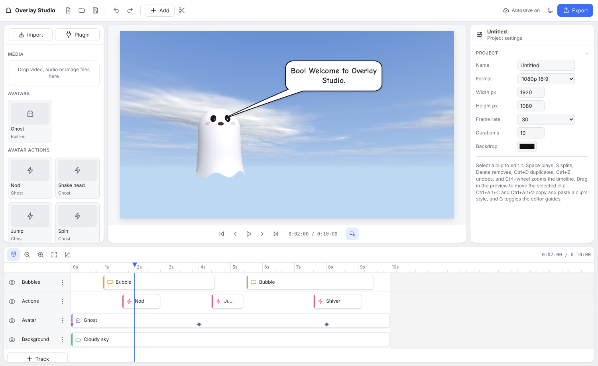

# Overlay Studio

A browser-only editor for animated video overlays: speech bubbles, titles, callouts, stickers,
redaction, 3D avatars and animated backdrops, composited over your footage and exported to MP4 or
WebM. The whole app is one HTML file ([`src/index.html`](src/index.html)) with no server and no
install.



## Features

- **One render path.** Every layer draws into a single WebGL canvas through three.js, so the
  preview is exactly what gets exported. Export encodes frame-exact with WebCodecs and muxes with
  Mediabunny, with clip audio and separate audio tracks mixed in.
- **Clips.** Video, images and stickers, speech/thought/shout/caption bubbles, titles and lower
  thirds, callout shapes and bezier arrows, redaction (blur, pixelate, bar), adjustment and effect
  layers, avatars, backdrops and avatar actions.
- **Animation.** Per-property keyframes with named easings or custom bezier curves in a curve
  editor, motion paths, in/out transitions, wiggle, and parenting to other clips or avatar anchors.
- **Plugins.** Avatars and backdrops are ES modules that are pure functions of time. Five ship
  built in (ghost, snowfall, star sphere, cloudy sky, hex vortex); more load from a URL or a dropped
  `.js` file. See [docs/PLUGINS.md](docs/PLUGINS.md).
- **Projects.** A single `.vproj` file with media embedded or linked to files on disk, autosave to
  the browser's private storage with recovery, undo/redo, style copy/paste and saved presets.

Chrome and Edge are the main targets. Safari and Firefox work where their WebCodecs support
allows, falling back to VP9/WebM.

## Quick start

Open `src/index.html` in Chrome, or serve the offline build:

```sh
npm run dev   # builds dist/ and serves it at https://localhost:8443
```

Drop footage onto the window, add overlays from the **Add** menu, and press **Ctrl+E** to export.

| Keys | Action |
| --- | --- |
| Space | Play / pause |
| ← / → (Shift) | Step a frame (a second) |
| Home / End | Go to start / end |
| S | Split the selected clip at the playhead |
| Delete | Delete the selection |
| G | Toggle guides |
| Ctrl+Z / Ctrl+Shift+Z | Undo / redo |
| Ctrl+D | Duplicate |
| Ctrl+Alt+C / Ctrl+Alt+V | Copy / paste style |
| Ctrl+S / Ctrl+Shift+S | Save / save consolidated |
| Ctrl+O, Ctrl+E | Open, export |

## Docs

- [Design](docs/DESIGN.md), the plan in [TODO.md](TODO.md), history in [CHANGELOG.md](CHANGELOG.md)
- [Building](docs/BUILD.md): how `dist/` is vendored for offline use
- Install: [in the browser](docs/INSTALL.browser.md), [as a desktop app](docs/INSTALL.desktop.md)
- Deploy: [GitHub Pages](docs/DEPLOY.github-pages.md), [Cloudflare](docs/DEPLOY.cloudflare.md),
  [Google Cloud](docs/DEPLOY.gcloud.md), [CodePen](docs/DEPLOY.codepen.md)
- [Writing plugins](docs/PLUGINS.md)

## License

Public domain under the [Unlicense](LICENSE). The vendored three.js and Mediabunny are MIT, and the
Google Fonts (Bangers, Comic Neue, Nunito, Patrick Hand) are OFL.
